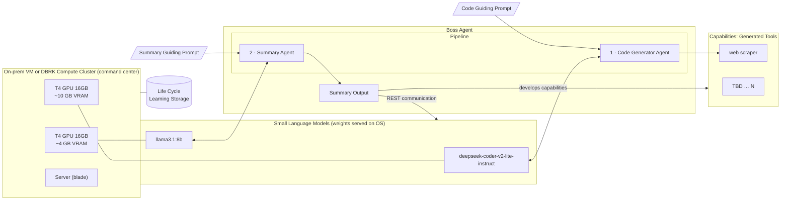
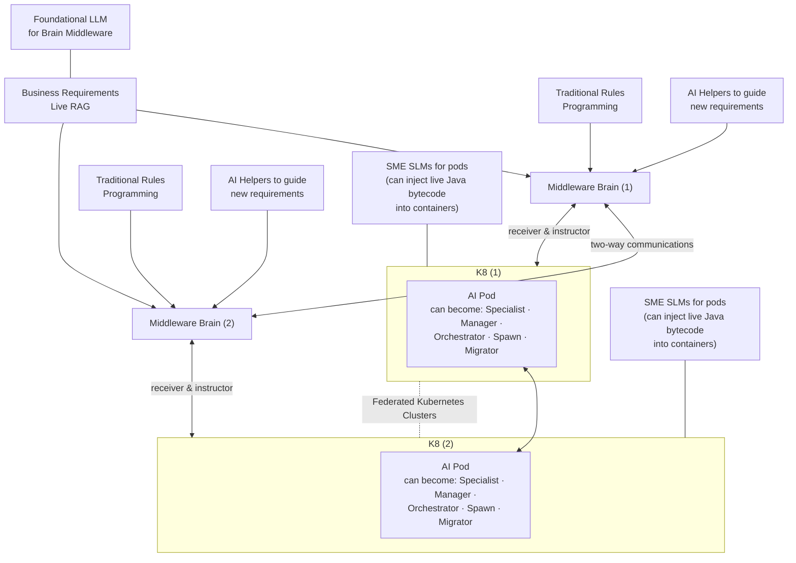
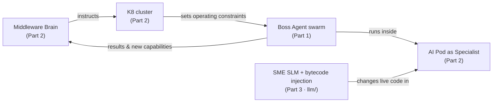

# Autonomous Agents — Federated

> *"The next Turing test evaluating AGI is when a human does not question the results."*
> — Thomas Bales, 2025

> **Project status: research design and prototype, parked.** The author is finishing graduate school at UT Austin and plans to resume work around mid-2027. Everything here is public so the ideas and code can be read and built on. Issues are welcome, but replies may be slow.

This repository holds two related architecture designs for self-directed AI agent systems, plus one working code prototype:

- **Part 1 and Part 2 are designs** (PDF diagrams). They work at **two different scales**, and this README keeps them separate.
- **Part 3 is code**: [`llm/`](llm/), a Java service that shows the *live bytecode injection* idea from Part 2 actually running.

| | **Part 1 — Boss Agent** | **Part 2 — Organic AI Growth (Federated)** |
|---|---|---|
| **Scope** | One autonomous agent (the *unit*) | Many agents across clusters (the *ecosystem*) |
| **Question it answers** | *How does one agent build its own tools?* | *How do agents grow, specialize, and move across infrastructure?* |
| **Runs on** | One on-prem VM / Databricks compute cluster with GPUs | Federated Kubernetes clusters |
| **Intelligence** | Small Language Models (SLMs), one per sub-agent | Foundational LLM ("Brain") + SME SLMs in pods |
| **Direction** | Pipeline: prompt → code → tool → summary | Two-way: Brain ⇄ Brain, Brain ⇄ K8, Pod ⇄ Pod |
| **Diagram** | [`docs/boss-agent.pdf`](docs/boss-agent.pdf) | [`docs/organic-ai-growth-federated.pdf`](docs/organic-ai-growth-federated.pdf) |
| **Code** | Uses the same model as Part 3 (DeepSeek-Coder) | **Part 3, [`llm/`](llm/)**, prototypes the "inject live Java bytecode" pod capability |

**In one sentence:** a **Boss Agent** is the worker, and **Organic AI Growth** is the federated system those workers live, grow, and migrate in.

---

## Contents

- [Part 1 — Boss Agent (Free Agent Architecture)](#part-1--boss-agent-free-agent-architecture)
- [Part 2 — Organic AI Growth (Federated Architecture)](#part-2--organic-ai-growth-federated-architecture)
- [Part 3 — `llm/`: Runtime Bytecode Injection (code)](#part-3--llm-runtime-bytecode-injection-code)
- [How the parts fit together](#how-the-parts-fit-together)
- [Repository layout](#repository-layout)

---

## Part 1 — Boss Agent (Free Agent Architecture)

**Full title:** *Modeling Human Behavior for AGI Systems — Free Agent Architecture*
**Tagline:** *AGI is Today. Why wait, just boss it out!*

A **Boss Agent** is a multi-agent system with **separation of concerns**, which the design calls *Micro-AGI software engineering*. Each Boss Agent is a *"Battleship Agent Class"*: it **creates its own tools for a job with limited human instructions**.

### Architecture



### How it works

1. **Code Generator Agent** (backed by **DeepSeek-Coder-V2-Lite-Instruct**) is guided by a *Code Guiding Prompt* and writes code. An **error feedback loop** sends failures back so it can fix the code.
2. The generated code becomes a **capability**, a reusable tool such as a *web scraper*. The tool list is open-ended (*TBD … N*).
3. **Summary Agent** (backed by **Llama 3.1 8B**) is guided by a *Summary Guiding Prompt* and turns the results into a **Summary Output**.
4. Agents talk over **REST**. They can send and receive information from other agents, but only within **communication constraints**.

### Key features

- **Llama for text, DeepSeek for code**: each sub-agent uses the model best suited to its task
- **Writes software on its own**, with an error feedback loop
- **A custom SLM for each agent**
- **Private and secure**: not tied to any model vendor
- **No token charges**: all inference runs locally
- **~140 extra server watts**, **~$2,000 extra hardware** (2× NVIDIA T4 16 GB)
- **Life Cycle Learning Storage** keeps what the agent learns over time
- Prompts, fine-tuned custom weights, and tool output are treated as **IP**

### Example Boss Agents in a swarm

*Swarm intelligence is real, and the SME agents to do this already exist.*
**The K8 determines the operating constraints.**

| Boss Agent | Job |
|---|---|
| **Network Shark Scanner** | Gets the IP points |
| **IT Permissions Boss Agent** | Asks for permissions |
| **Database Analyzer** | Looks at tables, determines access |
| **Bias Detector** | Finds bias in data, instructions, and text |

> Some spawns or other agents may have other AI/ML specialties, such as **reinforcement learning** or **trainable small DNNs**.

### Future possibilities: no OS

Run agents straight on an **FPGA (MicroBlaze soft processor)** with no operating system, at a **5 W maximum**, for even lower energy use.

---

## Part 2 — Organic AI Growth (Federated Architecture)

Part 1 describes a single agent. Part 2 describes the **ecosystem**: how AI pods are directed, change roles, and move across **federated Kubernetes clusters**, all governed by live business requirements.

### Architecture



### Layers (top to bottom)

| Layer | Component | Role |
|---|---|---|
| **Knowledge** | Foundational LLM | Powers the Brain middleware |
| | Business Requirements **Live RAG** | One source of truth for requirements, shared by every Brain |
| **Control** | **Middleware Brain** (one per cluster) | **Receiver and Instructor**: takes in signals from its cluster and sends instructions back |
| | Traditional Rules Programming | Deterministic guardrails that feed each Brain |
| | AI Helpers | Help turn **new requirements** into instructions |
| | Brain ⇄ Brain link | **Two-way communication** between Brains |
| **Execution** | **K8 clusters** | **Federated** Kubernetes clusters that host the agents |
| | **AI Pods** | Agents that change role over their lifetime (see below) |
| | **SME SLMs** | Subject-matter-expert small models for pods that can **inject live Java bytecode into running containers** |

### The AI Pod lifecycle ("organic growth")

Each AI Pod's role is not fixed. Like a cell, it can **become** one of these:

| Role | Meaning |
|---|---|
| **Specialist** | Does a focused task (for example, a Boss Agent from Part 1) |
| **Manager** | Coordinates other pods |
| **Orchestrator** | Directs workflows across pods |
| **Spawn** | Creates new pods |
| **Migrator** | Moves itself or its work to another federated cluster |

Pods in different clusters talk to each other directly (**Pod ⇄ Pod**). They also report to and take orders from their cluster's Brain.

---

## Part 3 — `llm/`: Runtime Bytecode Injection (code)

**This is the only runnable part of the repo.** Parts 1 and 2 are designs. Part 3 builds one specific capability from Part 2:

> *"SME SLMs for Pods — can inject live Java bytecode into containers"*

**In plain terms:** normally, changing a Java program means editing the source, rebuilding and restarting it. This service skips those steps. You send Java **source code over HTTP**, and the service **compiles it in memory, loads it into the already-running program and runs it**. A local AI model (DeepSeek-Coder) can write or optimize that code. Together, those let an AI agent **change running software inside a container without restarting it**.

| Piece | What it is |
|---|---|
| **Prompt side** | `POST /api/chat`, `POST /api/chat/bytecode`: send a prompt to the local DeepSeek-Coder SLM (for example, "write an ASM transformation for this method") |
| **Bytecode side** | `POST /api/chat/runtime/compile` · `execute` · `modify`: compile, load, run, and redefine Java classes **inside the live JVM** |
| **Stack** | Java 21 · Spring Boot 3.3 · Spring AI · `javax.tools` compiler · ByteBuddy · ASM · Podman/Docker |

**Status:** prototype. Compile and execute work. Method modification is experimental. The runtime endpoints run any code sent to them and have **no authentication**, so run the service only on a trusted network.

→ **Full details, endpoints and run instructions: [`llm/README.md`](llm/README.md)**

---

## How the parts fit together



- A **Boss Agent** (Part 1) is what an **AI Pod in the Specialist role** (Part 2) looks like inside.
- Part 1 states that **"the K8 determines the operating constraints"**. Part 2 defines that K8 layer and the Brain that controls it.
- Part 1's **Life Cycle Learning** and generated tools give Part 2's pods what they need to **spawn, specialize, and migrate**.

| Concern | Handled by |
|---|---|
| Writing code and building tools | **Part 1:** Boss Agent pipeline |
| Picking the right model for each sub-task | **Part 1:** one custom SLM per agent |
| Business rules and requirements | **Part 2:** Live RAG + Middleware Brain |
| Role changes, scaling, migration | **Part 2:** AI Pod lifecycle on federated K8 |
| Changing code that is already running | **Part 2** (design) → **Part 3** (working prototype in `llm/`) |

---

## Repository layout

```
.
├── README.md                              ← you are here
├── docs/
│   ├── boss-agent.pdf                     ← Part 1: Boss Agent / Free Agent Architecture
│   └── organic-ai-growth-federated.pdf    ← Part 2: Organic AI Growth / Federated K8
└── llm/                                   ← Part 3: runnable Java prototype (see llm/README.md)
    ├── src/main/java/com/ai/llm/
    │   ├── ChatController.java            ← REST endpoints (prompt + runtime)
    │   ├── RuntimeBytecodeService.java    ← in-memory compile, load, execute, redefine
    │   └── LlmApplication.java            ← Spring Boot entry point
    ├── src/main/resources/                ← local and container configs
    ├── Dockerfile · docker-compose.yml · deploy.bat
    └── docs/                              ← generated Javadoc
```

---

## Author

**Thomas Bales**, 2025
