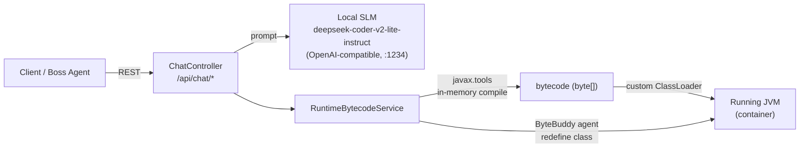

# `llm/` — Runtime Bytecode Injection Prototype

> **This is the working code behind one box in the federated diagram:**
> *"SME SLMs for Pods — can inject live Java bytecode into containers"*
> (see [Part 2 in the main README](../README.md#part-2--organic-ai-growth-federated-architecture)).

A Spring Boot 3 service (Java 21) does two jobs:

1. **Prompting:** it sends prompts to a **local SLM** (DeepSeek-Coder-V2-Lite-Instruct, the same code model as the Boss Agent) through Spring AI's OpenAI-compatible client.
2. **Bytecode injection:** it **compiles Java source in memory, loads it into the running JVM, executes it**, and tries to **redefine methods on live classes**, all inside a running container with no restart.



---

## Prompt side vs. bytecode side

| | **Prompt (LLM) endpoints** | **Bytecode (runtime) endpoints** |
|---|---|---|
| What they do | Ask the SLM for text or code | Change what runs inside the JVM |
| Needs the SLM running? | **Yes** | **No** |
| Endpoints | `POST /api/chat`<br/>`POST /api/chat/bytecode` | `POST /api/chat/runtime/compile`<br/>`POST /api/chat/runtime/execute`<br/>`POST /api/chat/runtime/modify`<br/>`POST /api/chat/runtime/asm-generate` |
| Tech | Spring AI (`ChatClient`) | `javax.tools.JavaCompiler`, custom `ClassLoader`, ByteBuddy, ASM |

---

## Endpoints

| Method & path | Body | What it does |
|---|---|---|
| `GET  /api/chat/test` | – | Health check, also used by the Docker `HEALTHCHECK` |
| `GET  /api/chat/hotswap-test` | – | Shows DevTools hot-swap working |
| `POST /api/chat` | `{"message"}` | Plain chat with the local SLM |
| `POST /api/chat/bytecode` | `{"javaCode","optimizationGoal"}` | **Prompt:** asks the SLM to write an **ASM 9.x transformation** for a method |
| `POST /api/chat/runtime/compile` | `{"className","javaCode"}` | Compiles source **in memory**, loads the class, creates an instance |
| `POST /api/chat/runtime/execute` | `{"className","methodName","args"}` | Calls a method on a class that `/compile` loaded |
| `POST /api/chat/runtime/modify` | `{"className","methodName","newImplementation"}` | Redefines a method on an already-loaded class through the ByteBuddy agent *(experimental, see Status)* |
| `POST /api/chat/runtime/asm-generate` | `{"javaCode","optimizationGoal"}` | Returns a **fixed ASM template** (does not call the LLM) |

### Example: compile and run code at runtime

```bash
curl -X POST localhost:8080/api/chat/runtime/compile -H "Content-Type: application/json" \
  -d '{"className":"Hello","javaCode":"public class Hello { public String hi(String n){ return \"Hi \" + n; } }"}'

curl -X POST localhost:8080/api/chat/runtime/execute -H "Content-Type: application/json" \
  -d '{"className":"Hello","methodName":"hi","args":["Boss"]}'
```

---

## Running it

**Prerequisites**
- **JDK 21**. A full JDK is required: runtime compilation needs `javac`, so a JRE will not work.
- A local OpenAI-compatible server (for example **LM Studio**) at `http://localhost:1234` serving `deepseek-coder-v2-lite-instruct`. You only need this for the prompt endpoints.

**Local**
```bash
./mvnw spring-boot:run          # Windows: mvnw.cmd spring-boot:run
```

**Container (Podman / Docker)**
```bash
podman-compose up -d --build    # or: docker compose up -d --build   (Windows: deploy.bat)
```
The container uses the `container` profile and reaches the model at `host.containers.internal:1234`.

### Config files

| File | Used when |
|---|---|
| `src/main/resources/application.properties` | Local run (DevTools hot-reload on) |
| `src/main/resources/application-container.properties` | Inside the container (DevTools off, binds `0.0.0.0:8080`) |

`-XX:+EnableDynamicAgentLoading` is set everywhere so the ByteBuddy agent can attach to the running JVM.

---

## Status: prototype

- `runtime/compile` and `runtime/execute` contain the core loop: in-memory compile, load, run.
- `runtime/modify` is **experimental**. The interceptor class name is built from two separate `System.currentTimeMillis()` calls, so the compiled class name usually won't match the name the service looks up afterwards.
- `runtime/asm-generate` returns a placeholder template. For real ASM output, use the LLM-backed `/bytecode` endpoint.
- `LlmApplicationTests.java` is in `src/main/resources`, not `src/test/java`, so Maven never runs it.

## ⚠️ Security warning

The `/runtime/*` endpoints **compile and execute any Java code sent to them, and there is no authentication**. That is intentional for this research prototype, but anyone who can reach port 8080 can run code inside the container. Run it only on a trusted local network, and add authentication and sandboxing before exposing it anywhere else.
